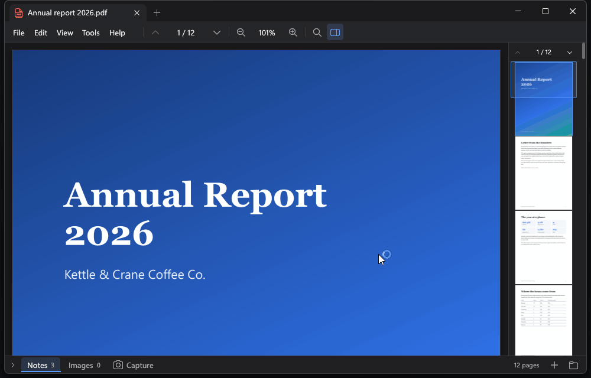

# whir

A fast, lean, native Windows app for everyday work. Double-click a file and it's on
screen, and each new file becomes a tab in the same window.



*Recorded in real time. The report and the timesheet are sample data.*

It does five things well:

- **Fast PDF viewer:** a 66-page PDF is on screen in about 150 ms, with text selection,
  search and a page minimap.
- **Fast screenshot tool:** press Ctrl+PrtSc anywhere, drag a region or click a window, and
  it opens ready to highlight, label, draw freehand and add arrows.
- **Fast CSV tool:** open, sort, edit and save huge files. A 300k-row CSV opens in about
  150 ms, and Find gets through an 870 MB file in about 0.3 s.
- **Simple, minimal notes and todos:** start typing and the note saves itself as plain
  Markdown. Flag one as a todo to keep it in sight.
- **Timesheets:** time your work against projects and milestones from a small dock, fill in
  the week on a grid, and close it out to CSV.

It opens images too. There's no installer and no web runtime: it's one portable folder of
about 14 MB, built with Rust, raw Win32 and Direct3D 11.

## Using it

Download the zip from [Releases](../../releases), unzip it anywhere you can write, and run
`whir.exe`. To have double-clicked files open in it, run `whir.exe --register` once, then
**Open with → Choose another app → whir → Always** for each file type.

Two things to know before you run it:
- whir isn't code-signed, so Windows SmartScreen may stop it the first time: **More info →
  Run anyway**.
- The capture dock keeps running after the window closes. It has a tray icon, and **Quit
  whir** there closes it. whir only starts with Windows if you turn that on.

**[docs/guide.md](docs/guide.md)** covers every key and mouse action, where things are kept,
the command line, and what's not there yet. It's also in the zip as `README.md`.

## Measured

Release build on a desktop with an NVIDIA GPU, with files in the OS cache.

| | window on screen | content on screen | private memory |
|---|---|---|---|
| second double-click (hand-off to the running window) | — | ~14 ms in the new process | — |
| bare launch (blank note) | ~90 ms | ~130 ms | ~65 MB |
| 6000×4000 JPEG | ~90 ms | ~150 ms | ~108 MB |
| 20 MB / 300k-row CSV | ~90 ms | ~150 ms | ~67 MB |
| 66-page PDF | ~90 ms | ~150 ms | ~107 MB |
| same CSV, `--warp` | — | ~72 ms | ~34 MB |
| the capture dock (`--dock`), idle | — | — | ~4 MB (a frozen screen's worth more while selecting) |

## Principles

- **Critical path first.** Decoding starts before the window exists, and the GPU initializes in
  parallel. PDFium loads only when a PDF is opened.
- **Event-driven.** No frame is drawn unless something changed, so idle CPU is 0%.
- **Never lock your files.** Everything is opened with full sharing and never memory-mapped, and
  handles are dropped when whir loses focus. Excel can save a CSV that's open in whir, and
  the CSV tab notices the change and offers to reload.
- **Never lose your work.** Saves go to a temp file next to the original and replace it
  atomically (`ReplaceFileW`, keeping permissions); notes save themselves; whir asks before
  closing anything unsaved, and waits for in-flight saves before exiting.
- **Memory follows the screen.**
  - Images keep a screen-sized level and decode full resolution only when you zoom in.
  - The CSV index costs about 1.25 MB per 10M rows.
  - PDF tiles live in an LRU with a 96 MB budget.
- **Two processes, one timesheet.** The dock and the window both change the timesheet and
  the todos: each change is made under a named mutex from a fresh read of the files, written
  atomically, and announced to the other process with a registered window message.

## Building

Requirements: Rust 1.95 or newer (MSVC toolchain), Visual Studio Build Tools with the
Windows SDK.

```powershell
scripts\fetch-pdfium.ps1   # pinned, SHA-256 verified PDFium build -> vendor\pdfium
cargo test --workspace
scripts\dist.ps1           # release build -> dist\whir\ and dist\whir-<version>-win-x64.zip
```

`cargo run -p whir -- <files>` works for development. Debug builds find `pdfium.dll` in `vendor\`,
and don't start the capture dock with the window (`cargo run -p whir -- --dock` does).

Diagnostics:
- A panic is written to `%LOCALAPPDATA%\whir\crash.log`.
- `WHIR_TRACE=1` appends a startup timeline to `%LOCALAPPDATA%\whir\trace.log`.
- `whir.exe --warp` renders with Windows' software rasterizer instead of the GPU driver.
- `WHIR_NOTES_DIR`, `WHIR_CAPTURES_DIR` and `WHIR_TIME_DIR` keep whir's files somewhere else,
  and `WHIR_NO_DOCK=1` doesn't start the capture dock with the window (for testing).

## License

[MIT](LICENSE). PDFium and the Rust crates in a release have licenses of their own, in the
zip's `licenses` folder.
